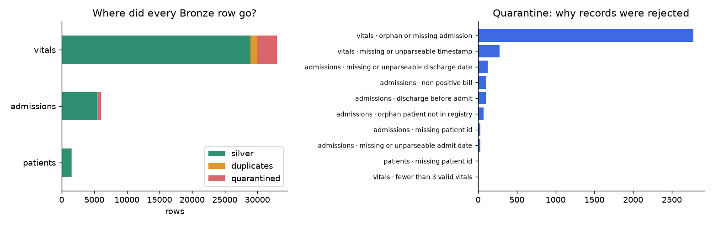
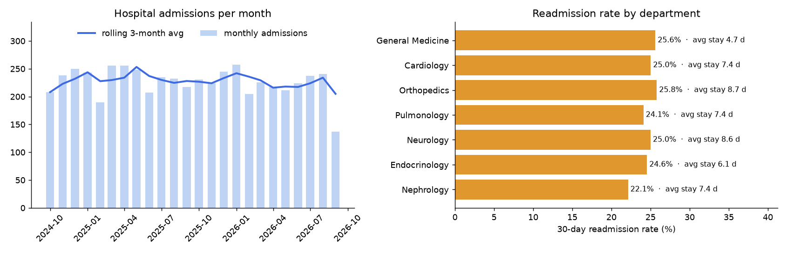
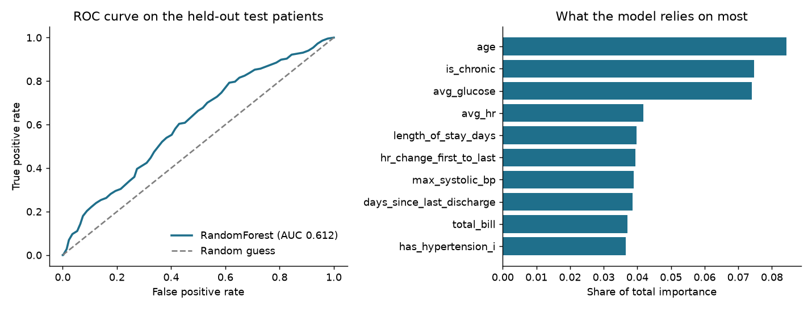

# Smart Healthcare Data Analytics and Prediction Platform

Big Data mid-term minor project. A PySpark data pipeline for a hospital group, built in the
**medallion** style: three messy source systems → **Bronze** (raw, traceable) → **Silver** (clean,
validated, rejects quarantined) → **PySpark processing** → **Gold** (model-ready datasets) → a **Spark MLlib**
model that predicts 30-day readmissions → an interactive **Streamlit dashboard**, automated with **Airflow**
and validated by automated tests.

> All data is **simulated** with a fixed random seed. No real patient information is used.

## Overview
Hospitals keep registration, admission and bedside-monitoring data in separate systems, each with its own
formats and errors. This project shows how to turn that raw, inconsistent data into something an analyst can
trust. It ingests a CSV export, a database table and a paginated REST API, preserves every raw record with full
lineage, cleans and validates it (while keeping every rejected record for review), and uses PySpark to produce
department KPIs, monthly trends and clinical vitals alerts, then builds Gold datasets and trains an MLlib classifier that
ranks admissions by **30-day readmission risk**. Predictions are validated on held-out patients and shown in a dashboard.

**Key features**
- Three source types in one pipeline: CSV, relational database, paginated REST API
- Bronze → Silver → processed layers stored as Parquet, with `_source_system`, `_batch_id`, `_ingested_at`, `_row_hash` lineage
- Data-quality handling: duplicates, nulls, wrong types, inconsistent values, invalid and orphan records
- Quarantine table with the reason each record was rejected, and a reconciliation check: `bronze = silver + duplicates + quarantine`
- PySpark processing: broadcast joins, aggregations and pivot, Spark SQL, window functions (`lag`, `lead`, `row_number`, `dense_rank`, rolling averages)
- Gold layer with leakage safeguards (open follow-up windows and deceased patients excluded from modelling)
- Spark MLlib: Logistic Regression vs Random Forest vs Gradient-Boosted Trees, patient-level train/validation/test split, class weighting
- Predictions stored as Parquet with risk bands; validated by actual readmission rate per band on held-out patients
- Streamlit dashboard (KPIs, trends, vitals alerts, model evaluation, patient risk worklist) reading the real outputs
- 19 automated validation tests, a one-command runner and an Airflow DAG that was executed end to end

```
 SOURCES (simulated)        BRONZE            SILVER                 PROCESSED            GOLD              MODEL + PREDICTIONS        DASHBOARD
 patients_registry.csv ─┐   raw text +         typed, standardised,   admission_features   ml_dataset        Spark MLlib pipeline       Streamlit
 hospital_his.db (DB)  ─┼─► lineage        ─►  validated; rejects ─►  dept_kpis, trends,─►  dept_monthly ─►   data/predictions/      ─►  dashboard/app.py
 vitals API, 12 pages  ─┘   (Parquet)          in data/quarantine/    window features      kpi_summary       risk score + band
 └──────────────────────── orchestrated by Airflow (airflow/dags) · validated by pytest (tests/) · maintained in GitHub ──────────────┘
```

## Problem
Patient registration, admissions and bedside vitals live in three systems with inconsistent formats
(mixed date formats, bills like `₹12,500` / `12500 INR`, °C and °F, duplicates, orphan records, sensor
glitches). Reports built on this are unreliable and avoidable 30-day readmissions go unnoticed.
**Users:** hospital administrators, ward doctors, quality team.

## What each stage does

| Stage | Code | What happens |
|---|---|---|
| Sources | `src/generate_sources.py` | Simulates a CSV export, a SQLite database table and a paginated REST API, with realistic data-quality problems injected on purpose |
| Bronze | `src/bronze.py` | Stores everything exactly as received (all columns as text) as Parquet, plus `_source_system`, `_source_file`, `_ingested_at`, `_batch_id`, `_row_hash`. Row counts are reconciled with the sources |
| Silver | `src/silver.py` | Handles missing values, duplicates, wrong types, inconsistent values and invalid records. Rejected rows go to `data/quarantine/` with the reason and the raw record. Asserts `bronze = silver + duplicates + quarantine` |
| Processing | `src/processing.py` | Filtering, broadcast join, transformations, aggregations + pivot, Spark SQL (CTE, window `RANK`) and window functions (`row_number`, `lag`, `lead`, running totals, rolling averages, `dense_rank`) |
| Gold | `src/gold.py` | `ml_dataset` (features known at discharge + label, with `label_observable` / `in_model_population` flags), `department_monthly`, `vitals_alert_rates`, `kpi_summary` |
| Model | `src/model.py` | MLlib `Pipeline`s (StringIndexer → OneHotEncoder → VectorAssembler → classifier), patient-level 70/15/15 split, model selection on validation PR-AUC, threshold tuned on validation, evaluation on test, predictions + metrics to Parquet, fitted pipeline saved |
| Dashboard | `dashboard/app.py` | Streamlit app with five tabs and sidebar filters; every number is read from the Gold / prediction outputs |

Stages run in this order: `generate → bronze → silver → process → gold → model`.

Helpers: `src/utils.py` (cleaning functions and lookup tables), `src/config.py` (paths/constants),
`src/spark_session.py`.

## Run it

Requirements: **Python 3.9+** and **Java 17 or 21** (Spark 4).

```bash
git clone <your-repo-url> && cd healthcare-data-platform
python -m venv .venv && source .venv/bin/activate      # Windows: .venv\Scripts\activate
pip install -r requirements.txt

python run_pipeline.py                 # all stages incl. Gold and the model (~1.5 minutes)
python run_pipeline.py --stage silver  # or a single stage
python -m pytest -q tests              # 19 validation checks
streamlit run dashboard/app.py         # open the dashboard (run the pipeline first)
```

Windows note: Spark writing Parquet sometimes needs Hadoop's `winutils`; WSL or Google Colab avoids that.
In Colab: `!apt-get install -y openjdk-17-jdk-headless -qq`, set `JAVA_HOME`, `!pip install pyspark`, upload the folder, run.

Outputs appear under `data/` (git-ignored, rebuilt deterministically: `bronze/ silver/ processed/ gold/ predictions/ models/ quarantine/`), `reports/` (reconciliation, cleaning report, `model_report.json`, comparison, feature importance) and `reports/figures/`.
`notebooks/Smart_Healthcare_Pipeline_Minor_Project.ipynb` is the same pipeline as a single narrated notebook with outputs saved.

## Results of a run

Row accounting (`reports/reconciliation.csv`) - every Bronze row is accounted for:

| Entity | Bronze | Silver | Duplicates removed | Quarantined | Kept |
|---|---:|---:|---:|---:|---:|
| patients | 1,566 | 1,500 | 60 | 6 | 95.8% |
| admissions | 6,040 | 5,435 | 147 | 458 | 90.0% |
| vitals | 32,987 | 28,974 | 960 | 3,053 | 87.8% |

The full list of cleaning actions is in `reports/silver_cleaning_report.csv`. Quarantined vitals are
mostly readings that belong to admissions that were themselves rejected (2,777).

`admission_features` (5,435 rows × 48 columns) carries the target label `readmitted_within_30d`
(24.9% positive), computed with `lead()` over each patient's admission history, plus patient,
admission and vitals-alert features.

**Gold and model.** The modelling population is 5,164 admissions (271 excluded: deceased, or the 30-day follow-up
window was still open at the snapshot date). Split by patient: 3,503 train / 827 validation / 834 test.

| Model | Validation ROC-AUC | Validation PR-AUC | Test ROC-AUC |
|---|---:|---:|---:|
| Logistic Regression | 0.631 | 0.404 | 0.602 |
| **Random Forest (selected)** | 0.652 | 0.421 | 0.612 |
| Gradient-Boosted Trees | 0.617 | 0.368 | 0.598 |

On the held-out test patients the selected model reaches PR-AUC 0.350 against a 0.260 base rate, and the 20% of
admissions it ranks highest contain 28% of all readmissions (lift 1.40×). Actual readmission rates rise with the
predicted band: Low 19.8% → Medium 30.6% → High 36.1%. Most influential features: age, chronic condition, average glucose,
heart rate, length of stay.

> These scores are modest on purpose and should be read as such: the data is simulated and the readmission risk
> in the generator is deliberately moderate (it rises with severity, age, chronic conditions, emergency admission and
> longer stays; 14% overall). Real readmission models typically land around 0.6-0.7 ROC-AUC as well. Logistic Regression and
> Random Forest are within about 0.01 of each other, so the winner can flip between machines or Spark versions
> (the notebook run picked Logistic Regression); the conclusions do not change.





## Project layout

```
healthcare-data-platform/
├── run_pipeline.py            # entry point: runs the stages in order
├── requirements.txt
├── src/                       # one module per stage (generate, bronze, silver, processing, gold, model) + helpers
├── dashboard/app.py           # Streamlit dashboard
├── tests/                     # validation tests for the finished pipeline
├── airflow/dags/              # DAG: generate >> bronze >> silver >> process >> validate
├── notebooks/                 # narrated notebook version with saved outputs
├── reports/                   # reconciliation + cleaning report + figures
└── data/                      # generated layers incl. gold/, predictions/, models/ (git-ignored)
```

## Testing and automation
- `tests/test_pipeline_outputs.py` (19 tests): Bronze counts equal source counts, lineage columns present,
  reconciliation holds, unique non-null Silver keys, referential integrity (vitals → admissions → patients),
  valid dates/bills/severity, clinical value ranges, systolic > diastolic, a binary and consistent readmission label,
  a leakage-free and fully imputed Gold layer, patient-disjoint train/validation/test sets, a model better than chance on
  held-out patients, higher predicted risk meaning higher actual readmission rate, well-formed predictions, and a
  smoke test that renders the dashboard.
- `airflow/dags/healthcare_pipeline_dag.py` chains `generate >> bronze >> silver >> process >> gold >> model >> validate_outputs`.
  It was executed with Airflow 3 (`airflow dags test`): all seven tasks succeeded, including the 19 tests.
  To try it: `pip install apache-airflow`, set `AIRFLOW_HOME` and `PROJECT_DIR`, run `airflow db migrate`, then
  `airflow dags test smart_healthcare_medallion_pipeline 2026-10-31`. The dashboard is a long-running service, so it is started
  with `streamlit run`, not as a DAG task.

## Design decisions
- **Nothing is silently deleted.** Rejects are quarantined with a reason; duplicates and rejects are counted and reconciled.
- **Bronze stays raw** (strings only) so cleaning logic can change without re-ingesting.
- **Imputation is flagged** (`age_imputed`, `bill_imputed`, `severity_imputed`, `n_values_imputed`).
- **Blood pressure is imputed as a pair** so systolic can never fall below diastolic (found by the tests).
- **Honest evaluation:** split by patient, open follow-up windows and deceased patients excluded, threshold tuned on validation only, no feature derived from the next admission.

## Limitations
- Simulated data; model scores reflect the relationships built into the simulation, not real clinical performance.
- The database source is SQLite read through Python (on a cluster this would be `spark.read.jdbc`); the API is a local mock.
- Runs in Spark local mode on one machine; the same code would run on a cluster, but that was not tested here.
- The dashboard runs locally; it is not deployed to a hosting service.
